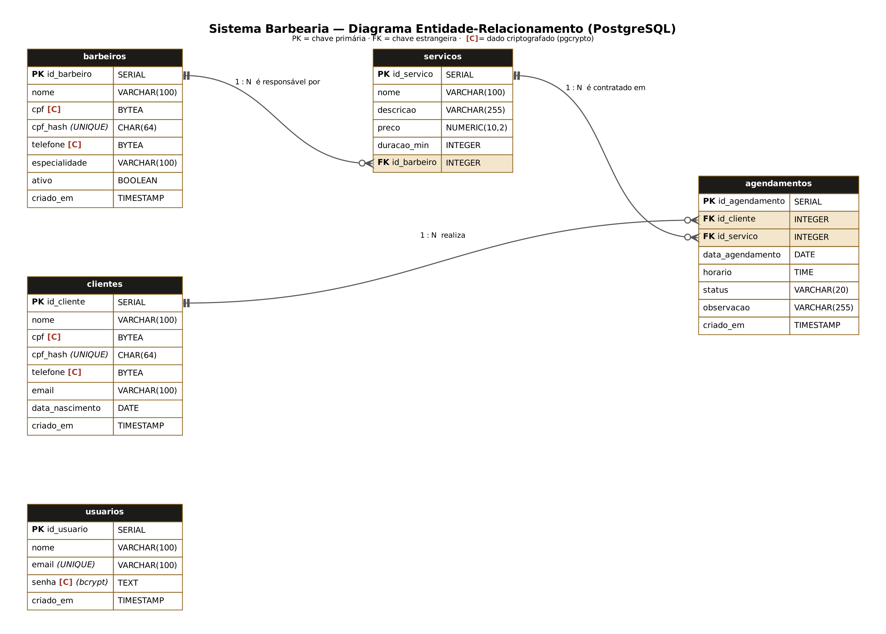

# ✂ Sistema de Gestão e Agendamento para Barbearia

Projeto do **SAEP – Técnico em Desenvolvimento de Sistemas** (Unidade Curricular: Desenvolvimento de Sistemas).
Sistema web para cadastro de clientes, barbeiros e serviços e para o agendamento de horários, com autenticação com tempo de expiração e criptografia de dados sensíveis (LGPD).

**Tecnologias:** Node.js · Express · EJS · PostgreSQL (pgAdmin) · pgcrypto · express-session

---

## 📁 Estrutura do repositório

```
saep-barbearia/
├── README.md              ← Documentação de software (Entrega 1)
├── docs/
│   ├── DER.png            ← Diagrama Entidade-Relacionamento (Entrega 2)
│   ├── DER.pdf
│   └── der.dot            ← fonte do diagrama (Graphviz)
├── saep_db.sql            ← Script de criação e população do banco (Entrega 3)
└── sistema/               ← Código-fonte (Entregas 4 a 8)
    ├── app.js             ← servidor Express, sessão com expiração, rotas
    ├── package.json
    ├── .env.example       ← configuração do banco e da chave de criptografia
    ├── src/
    │   ├── db.js              ← conexão com o PostgreSQL (usuário/senha)
    │   ├── criarBanco.js      ← cria o banco e as tabelas automaticamente
    │   ├── autenticacao.js    ← middleware que protege as rotas
    │   ├── util.js            ← validações (CPF, telefone, e-mail) e formatação
    │   └── rotas/
    │       ├── login.js         ← Entrega 4: Login / Logout
    │       ├── painel.js        ← Entrega 5: Painel principal
    │       ├── clientes.js      ← Entrega 6: Clientes (com busca)
    │       ├── barbeiros.js     ← Entrega 7: Barbeiros
    │       ├── servicos.js      ← Entrega 7: Serviços (vinculados a barbeiro)
    │       └── agendamentos.js  ← Entrega 8: Agendamentos
    ├── views/             ← telas (EJS)
    └── public/css/        ← estilo
```

---

## 🚀 Como executar

**Pré-requisitos:** Node.js 18+ e PostgreSQL (pgAdmin) ligado.

1. **Configure a senha do seu PostgreSQL** em `sistema/src/db.js` (linha `password`) — ou copie `.env.example` para `.env` e preencha lá.
2. **Instale e rode**
   ```bash
   cd sistema
   npm install
   npm start
   ```
   Na primeira vez o próprio código **cria o banco `saep_db`, as tabelas e os dados iniciais** (executando o `saep_db.sql`). Nas próximas vezes ele só confere que está tudo pronto.
3. Acesse **http://localhost:3000**

| Comando | O que faz |
|---|---|
| `npm start` | Cria o banco se não existir e liga o sistema |
| `npm run banco` | Apaga e recria todas as tabelas com os dados iniciais (zera o sistema) |

> Também dá para criar manualmente pelo pgAdmin: crie o banco `saep_db`, abra o **Query Tool** e execute o `saep_db.sql`.

### Usuários de teste

| E-mail | Senha |
|---|---|
| admin@barbearia.com | 123456 |
| carla@barbearia.com | 123456 |
| marcos@barbearia.com | 123456 |

---

## 📋 Requisitos Funcionais

| Código | Requisito | Descrição |
|---|---|---|
| **RF01** | Autenticar usuário | O sistema deve permitir o login com e-mail e senha cadastrados. |
| **RF02** | Validar login | O sistema deve validar os campos e exibir mensagem quando estiverem vazios, com e-mail inválido ou quando usuário/senha não conferirem ("Usuário ou senha inválidos."). |
| **RF03** | Expirar sessão | A sessão deve expirar após 30 minutos sem uso (configurável), exigindo novo login. |
| **RF04** | Encerrar sessão | O sistema deve permitir o logout a partir de qualquer tela. |
| **RF05** | Exibir painel principal | Após o login, o painel deve exibir o nome do usuário logado, atalhos para todas as funcionalidades, totais e os próximos atendimentos. |
| **RF06** | Cadastrar cliente | Cadastrar cliente com nome, CPF, telefone, e-mail e data de nascimento. |
| **RF07** | Editar / excluir cliente | Alterar e excluir clientes (a exclusão é bloqueada se o cliente tiver agendamentos). |
| **RF08** | Buscar cliente | O usuário informa um termo e, ao confirmar, a listagem é atualizada mostrando apenas os registros correspondentes (nome, e-mail, CPF ou telefone). |
| **RF09** | Cadastrar barbeiro | Cadastrar, editar, ativar/inativar e excluir barbeiros (nome, CPF, telefone, especialidade). |
| **RF10** | Cadastrar serviço | Cadastrar, editar e excluir serviços/cortes (nome, descrição, preço, duração). |
| **RF11** | Vincular serviço a barbeiro | Todo serviço deve obrigatoriamente ser associado a um barbeiro responsável previamente cadastrado. |
| **RF12** | Agendar atendimento | Agendar um cliente para um serviço em data e horário definidos. |
| **RF13** | Impedir choque de horário | O sistema não deve permitir dois atendimentos sobrepostos para o mesmo barbeiro (considerando a duração do serviço). |
| **RF14** | Listar agenda | Listar todos os agendamentos ordenados por dia e horário, com os dados completos do cliente, do serviço e do barbeiro. |
| **RF15** | Gerenciar status | Concluir, cancelar, editar e excluir agendamentos; filtrar por dia e status. |

## 🔒 Requisitos Não Funcionais

| Código | Requisito |
|---|---|
| **RNF01** | Senhas armazenadas com hash **bcrypt** (`crypt(senha, gen_salt('bf'))` – pgcrypto). Não é possível recuperar a senha original. |
| **RNF02** | CPF e telefone de clientes e barbeiros armazenados **criptografados** (`pgp_sym_encrypt`) – atendimento à LGPD. A chave fica no arquivo `.env`, fora do código. |
| **RNF03** | CPF exibido mascarado nas listagens (`***.456.789-**`). |
| **RNF04** | Duplicidade de CPF impedida por um hash HMAC-SHA256 (`cpf_hash` UNIQUE), sem guardar o CPF aberto. |
| **RNF05** | Todas as consultas usam parâmetros (`$1, $2…`), evitando SQL Injection. |
| **RNF06** | Cookie de sessão `HttpOnly` e `SameSite=Lax`; sessão regenerada no login. |
| **RNF07** | Rotas internas acessíveis apenas com usuário autenticado. |
| **RNF08** | Interface responsiva (computador e celular). |
| **RNF09** | Integridade referencial garantida por chaves estrangeiras (`ON DELETE RESTRICT`). |

## 📐 Regras de Negócio

| Código | Regra | Onde foi implementada |
|---|---|---|
| **RN01** | Pelo menos 3 registros em todas as tabelas | `saep_db.sql` (3 usuários, 4 clientes, 4 barbeiros, 5 serviços, 6 agendamentos) |
| **RN02** | Mensagem em caso de falha na autenticação | `src/rotas/login.js` |
| **RN03** | Senha e CPF criptografados no banco | `saep_db.sql` + todas as rotas de cadastro |
| **RN04** | Painel com nome do usuário, navegação e logout | `views/painel.ejs`, `views/partials/topo.ejs` |
| **RN05** | Busca na tela de clientes | `src/rotas/clientes.js` (`/clientes?busca=`) |
| **RN06** | Serviço obrigatoriamente vinculado a barbeiro | `servicos.id_barbeiro NOT NULL` + validação em `src/rotas/servicos.js` |
| **RN07** | Agenda ordenada por dia e horário com dados completos | `src/rotas/agendamentos.js` (`ORDER BY data_agendamento, horario`) |

---

## 🗂 Modelo de dados (DER)



| Tabela | Descrição | Relacionamentos |
|---|---|---|
| `usuarios` | Quem acessa o sistema | — |
| `clientes` | Clientes da barbearia | 1 cliente → N agendamentos |
| `barbeiros` | Profissionais | 1 barbeiro → N serviços |
| `servicos` | Cortes e serviços oferecidos | N serviços → 1 barbeiro; 1 serviço → N agendamentos |
| `agendamentos` | Horários marcados | N → 1 cliente; N → 1 serviço (o barbeiro vem pelo serviço) |

---

## 🔐 Como funciona a segurança

- **Login:** a senha digitada é conferida pelo próprio PostgreSQL:
  `SELECT … FROM usuarios WHERE email = $1 AND senha = crypt($2, senha)` — se a senha estiver errada, nenhum registro volta.
- **Expiração:** `express-session` com `maxAge` de 30 min e `rolling: true` (o prazo conta a partir da última ação). Ao expirar, qualquer rota protegida redireciona para o login com o aviso *"Sua sessão expirou…"*.
- **Dados sensíveis:** gravados com `pgp_sym_encrypt(valor, chave)` e lidos com `pgp_sym_decrypt(coluna, chave)`. No pgAdmin, um `SELECT cpf FROM clientes` mostra só bytes cifrados.

Para conferir no pgAdmin:
```sql
SELECT nome, cpf FROM clientes;   -- aparece cifrado
SELECT nome, pgp_sym_decrypt(cpf, 'barbearia_saep_2026') AS cpf FROM clientes;  -- com a chave
```

---

## 🧪 Casos de teste realizados

| # | Cenário | Resultado esperado |
|---|---|---|
| 1 | Login com campos vazios | "Preencha o e-mail e a senha." |
| 2 | Login com senha errada / usuário inexistente | "Usuário ou senha inválidos." |
| 3 | Login correto | Painel com "Olá, *nome*" |
| 4 | Acessar `/painel` sem login ou após expirar | Volta ao login com aviso de sessão expirada |
| 5 | Buscar cliente por nome, CPF ou telefone | Lista só os correspondentes |
| 6 | Cadastrar cliente com CPF inválido ou repetido | Mensagem de erro, nada é gravado |
| 7 | Cadastrar serviço sem barbeiro | "Selecione o barbeiro responsável pelo serviço." |
| 8 | Agendar no mesmo horário do mesmo barbeiro | "Choque de horário: o barbeiro já atende…" |
| 9 | Agendar em data passada | "Não é possível agendar em data/horário que já passou." |
| 10 | Excluir cliente/barbeiro/serviço em uso | Exclusão bloqueada com mensagem |
